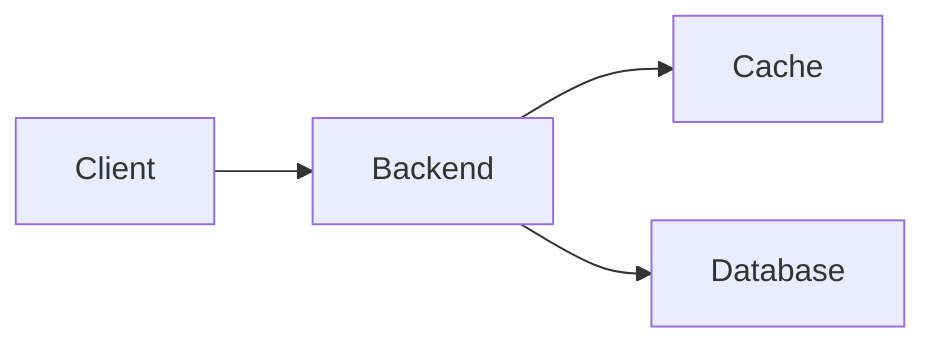

<div align="center">


# Liveboard

**Build a system. Send a request. See what happens.**

A visual system design workbench with executable diagrams, traffic experiments, and incident challenges.


[](LICENSE)

[Get started](#get-started) · [Try a scenario](#try-a-scenario) · [How it works](#how-it-works) · [Development](#development)

</div>

---

Liveboard turns a system diagram into a running simulation. Connect a client to a backend, add a cache and database, then follow a request through the system. Change the settings and measure the effect.

Use it to explore a design, practice an interview, or build an exercise for someone else.

## What you can do

- **Build on a canvas.** Add components, connect their ports, and configure each component or connection in the inspector.
- **Follow execution.** Inspect request traces, responses, cache entries, and queue state. Pause or step through the simulation.
- **Test under load.** Compare repeatable traffic experiments using success rates, response percentiles, database reads, and queue pressure.
- **Introduce failures.** Take components offline, slow database connections, or configure retries and circuit breakers.
- **Solve incidents.** Diagnose broken starter systems and verify a fix against traffic objectives and resource limits.
- **Prepare an interview.** Record requirements and design decisions, estimate capacity, and export an HTML report with measured evidence.

Your workspace saves in your browser. Download boards as JSON, then open them again or drag them onto the workspace. Exercises and submissions are portable files too. No account or API keys are required.

## Get started

Use Node.js **22.x starting at 22.12**, **24.x**, or **26+**.

```sh
npm ci
npm run dev
```

Open [localhost:5173](http://localhost:5173).

For a first run:

1. Open **Add**, expand **Templates**, and select **Cache-aside API**.
2. Send a request to `/users/1`. Inspect the trace as the backend reads the database and fills the cache.
3. Send the request again to see a cache hit.
4. Select a component to change its settings. Open **Run** to inspect execution and generate traffic.

Press `/` to search for components. Press `Escape` to hide panels. Use the Board menu to save or open files.

## Try a scenario

| Template | Explore |
| --- | --- |
| Cache-aside API | Cache misses, hits, expiry, and eviction |
| Load-balanced API | Routing across backend instances with different capacities |
| Checkout system | Parallel service calls followed by queued fulfillment |
| Redis cache | Commands, memory limits, and eviction policies |
| Kafka stream | Partitions, consumer groups, offsets, commits, and replay |
| Message queue | Acknowledgments, redelivery, and dead letters |
| Primary and replica | Replication delay, read settings, and database capacity |
| API gateway | Rate limits and burst allowances |
| Dependency resilience | Connection failures, timeouts, retries, and circuit breakers |

The **Challenges** panel includes six incidents, from launch-day overload to checkout under pressure. Each exercise defines a starter system, protected settings, and measurable pass conditions. You can also create an exercise from your own board.

## How it works

The canvas defines the topology and configuration. A TypeScript engine runs in a Web Worker, advances a virtual clock, and emits execution state. React Flow renders the components and traffic.



In the cache-aside template, the backend checks the cache first. A miss triggers a database read and cache fill. Later requests can use the cached record until it expires or is evicted.

Experiments run a captured configuration with a defined workload and optional failure schedule. Reports include response percentiles and count unfinished requests against success. Timings and component behavior come from the simulation model.

## Development

| Command | Purpose |
| --- | --- |
| `npm run dev` | Start the development server on port 5173 |
| `npm test` | Run the Vitest suite |
| `npm run typecheck` | Check TypeScript types |
| `npm run check` | Run tests and create a production build |
| `npm run build` | Build and assemble the standalone release |
| `npm run preview` | Start the standalone production server |

The app uses Next.js, React, and React Flow. Simulation logic and its tests live together under `src/simulation/`.

```text
src/
  app/          Workspace, canvas controls, and browser persistence
  board/        Board documents, component rendering, and connections
  simulation/   Simulation engine, worker, and component models
  challenges/   Exercise definitions, constraints, and verification
  interview/    Interview workspace, capacity estimates, and reports
  inspector/    Component and connection settings
  labs/         Traffic controls and technology labs
  scenarios/    Composed example systems
```

### Production build

```sh
npm run build
npm run preview
```

Open [localhost:3000](http://localhost:3000). Set `PORT` to use another port.

The build assembles `.next/standalone/` with browser assets and public files. To run the release independently, copy that directory and run `node server.js` inside it.

GitHub Actions runs tests and builds the app. Successful runs upload a `liveboard-next-build` artifact containing the standalone release. Deployment is separate.

## License

[MIT](LICENSE)
